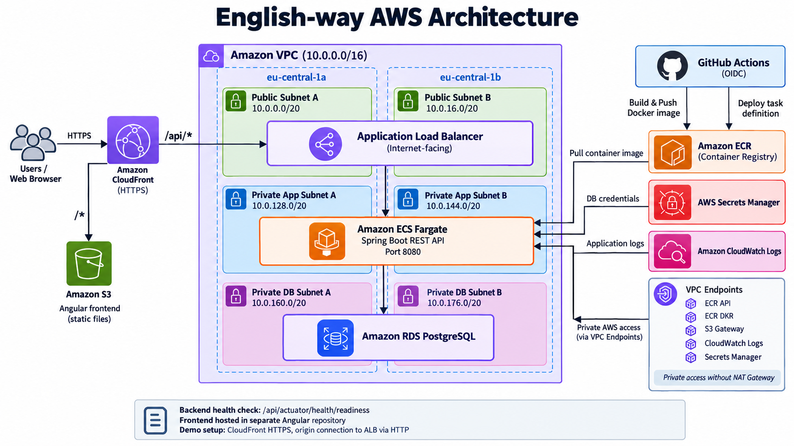
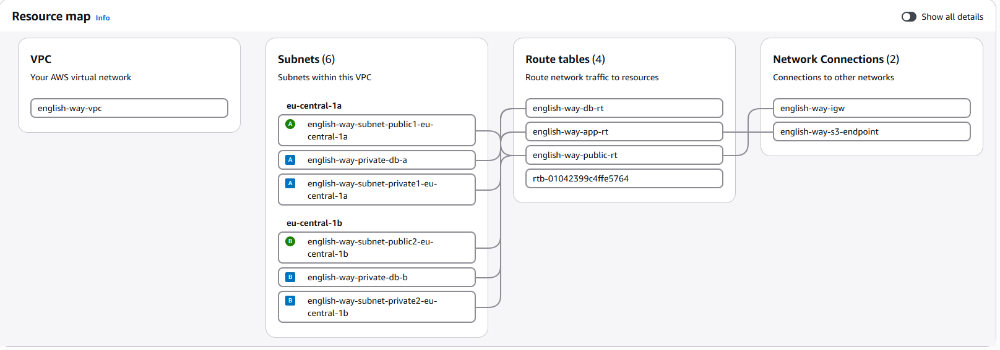

 # English-way — Spring Boot Backend

A Java 17 / Spring Boot REST API for **English-way**, an English-learning web application. The backend is deployed as a Docker container on **Amazon ECS with AWS Fargate**, with PostgreSQL hosted on **Amazon RDS**. An Angular frontend lives in a separate repository and is delivered through Amazon S3 and CloudFront.

This project is also a hands-on demonstration of deploying a containerized backend to AWS using private networking, managed credentials, health checks, and GitHub Actions CI/CD.

## Architecture

```text
Users
  |
  v
Amazon CloudFront (HTTPS)
  |-- /*       --> Amazon S3 (Angular frontend)
  |
  `-- /api/*   --> Application Load Balancer
                         |
                         v
                   Amazon ECS Fargate
                   Spring Boot :8080
                         |
                         v
                   Amazon RDS PostgreSQL

GitHub Actions --(OIDC)--> Amazon ECR --> ECS deployment
                                   |
                      CloudWatch Logs / Secrets Manager
```



The AWS VPC separates the infrastructure into **public subnets for the ALB**, **private application subnets for ECS**, and **database subnets for RDS**, across two Availability Zones. ECS tasks access required AWS services through VPC endpoints rather than a NAT gateway.



> **Security note:** The initial demo architecture used HTTPS at CloudFront with HTTP between CloudFront and the ALB. For production use, we should configure HTTPS on the CloudFront-to-origin connection before transmitting real credentials or tokens.

## Technology stack

| Area | Technologies |
| --- | --- |
| Backend | Java 17, Spring Boot, REST API |
| Database | PostgreSQL, HikariCP, Flyway |
| Security | Spring Security, JWT authentication, BCrypt |
| Build & packaging | Gradle, Docker (multi-stage build) |
| Compute & image registry | Amazon ECS Fargate, Amazon ECR |
| Networking | Amazon VPC, Application Load Balancer, VPC Endpoints |
| Database & secrets | Amazon RDS PostgreSQL, AWS Secrets Manager |
| Observability | Amazon CloudWatch Logs, Spring Boot Actuator |
| Delivery | GitHub Actions, AWS IAM OIDC roles |
| Frontend (separate repository) | Angular, Amazon S3, Amazon CloudFront |

## Backend responsibilities

The backend provides REST endpoints for the English-way application, including authentication and learning-related functionality. The project uses:

- Spring Security and JWT-based authentication and authorization.
- PostgreSQL persistence with a HikariCP connection pool.
- Flyway database migrations during application startup.
- Spring Boot Actuator readiness checks for load balancer health monitoring.
- Environment-based configuration for running locally or in ECS.

## Running locally

### Requirements

Create the .env file based on .env.sample.

| Variable | Purpose | Example |
| --- | --- | --- |
| `DB_HOST` | PostgreSQL hostname | `localhost` |
| `DB_PORT` | PostgreSQL port | `5432` |
| `DB_NAME` | Database name | `english-way` |
| `DB_USERNAME` | Database username | `postgres` |
| `DB_PASSWORD` | Database password | Set locally; do not commit |
| `SERVER_PORT` | HTTP server port | `8080` |

The application reads these values through `application.yml` and uses the `/api` servlet context path.

Locally this project required Docker Desktop.
Project start by command:

```bash
docker compose -f docker-compose.yml -up
```
The application may require additional project-specific configuration values (such as frontend URL or JWT settings); consult `application.yml` and the relevant security configuration before running it.

### Health check

```http
GET http://localhost:8080/api/actuator/health/readiness
```

Expected successful response:

```json
{"status":"UP"}
```

The Actuator health endpoint is permitted without authentication so that the AWS ALB can monitor backend readiness.

## Docker

The backend is packaged using a multi-stage Docker build: Gradle compiles the application and a Java 17 runtime image runs the resulting JAR.

```bash
docker build -t english-way-backend .
```

Pass database settings securely when running the container; do not bake credentials into the image.

## AWS deployment

The deployed AWS components include:

1. **ECR** — stores versioned backend Docker images.
2. **ECS Fargate** — runs the Spring Boot task in private application subnets.
3. **ALB** — routes `/api/*` traffic to ECS and monitors `/api/actuator/health/readiness`.
4. **RDS PostgreSQL** — provides the managed relational database.
5. **Secrets Manager** — stores database credentials; ECS injects the required JSON secret field into `DB_PASSWORD`.
6. **VPC Endpoints** — enable private access to ECR, CloudWatch Logs, Secrets Manager, and S3 without a NAT gateway.
7. **CloudWatch Logs** — captures application output and startup errors.
8. **CloudFront** — routes API requests to the ALB and serves the Angular frontend from S3.


### CI/CD workflow

On changes to the backend repository's deployment branch, GitHub Actions:

1. Authenticates to AWS using **OIDC**, without storing long-lived AWS access keys in GitHub.
2. Builds the Docker image.
3. Pushes the image to ECR, tagged with the Git commit SHA.
4. Updates the ECS task definition to reference the new image.
5. Deploys the new task definition to the ECS service and waits for service stability.

IAM permissions for the GitHub deployment role and the ECS task execution role are scoped separately. The task execution role has permission to read the required Secrets Manager secret and pull the image from ECR.

## Configuration and security

- The ECS task definition uses environment variables for non-sensitive settings and `valueFrom` for `DB_PASSWORD`.
- Only the ALB is intended to be publicly reachable; ECS tasks and the RDS instance remain in private subnets.
- The RDS security group permits PostgreSQL traffic on port `5432` from the ECS task security group.
- The ECS security group permits application traffic on port `8080` from the ALB security group.
- The Actuator health endpoint is publicly accessible through the configured API path; avoid exposing sensitive Actuator endpoints.
- Review the frontend-origin CORS allowlist when changing the CloudFront domain.

## Project status

The backend has been deployed to AWS and integrated with the separately hosted Angular frontend. This repository serves as both an application backend and a practical portfolio example of AWS-based container deployment, CI/CD, and cloud networking.

## Related repository

The Angular frontend is maintained in a **separate repository**. 
Add its GitHub URL is https://github.com/maksim-web-dev/EnglishWayPlatform_Angular
